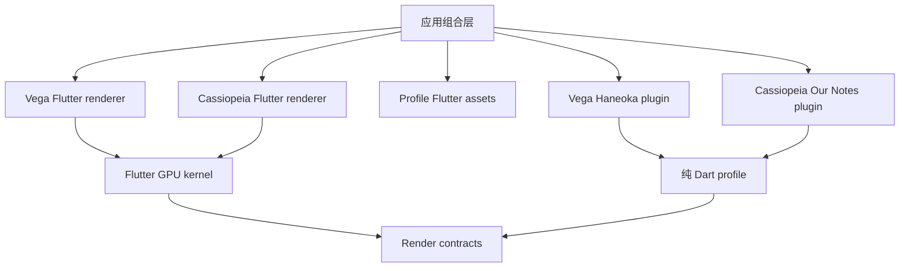

# Haneoka render profile

`haneoka_render_profile` 提供纯 Dart 的源数据模型、动画曲线、粒子积分、投影、材质描述和通用绘制契约适配。Vega 和 Cassiopeia 的游戏插件在这里共享原作表现规则。

`flutter/` 是可选的 `haneoka_render_profile_flutter` 包，负责 Flutter 的资源声明、Shader bundle 和资源地址。应用组合层导入它，并把资源交给加载器。纯计算包和游戏插件使用相对资源标识。



两个 renderer 接收通用场景和资源契约。游戏规则、资源选择与原作动画行为由游戏插件及 profile 提供；Flutter 的窗口、文件、音频和资源定位由宿主组合。

独立检查纯 Dart 部分：

```sh
dart pub get
dart analyze lib
```

公共绘制合同固定到 `render-kernel-flutter` 的 Git 版本；本地联调可使用各包自己的 `pubspec_overrides.yaml`。根目录的 `assets`、`shaders` 是通向 `flutter/` 的兼容链接，现有资源生产器继续写入同一份文件。

主题通过 `flutter/assets/profile/manifest.json` 声明能力、逐文件 SHA-256 和字节长度。更新资源后运行 `node tool/build-manifest.mjs`，发布前用 `node tool/build-manifest.mjs --check` 核对清单。Flutter 加载器在实际读取时验证文件，大型文本沿用 Flutter 的后台解码方式。

章节保留提供方、版本和媒体身份，视觉主题另有身份和资源清单。历史测量包的 `sourceId` 记录测量来源；新字体、图像和布局校准分别保留其实际来源。

正式故事字体与精灵使用已校验的 descriptor、对象档案和输出文件更新：

```sh
node tool/export-story-assets.mjs --inputs tool/story-assets-v56.json --profile flutter/assets/profile
```

工具沿用正式字体 compact 格式，核验输入 SHA256，记录每份资产的服务器、资源版本和原始输出；布局和动画保持原有来源。生产工具使用 Node.js 24+。
