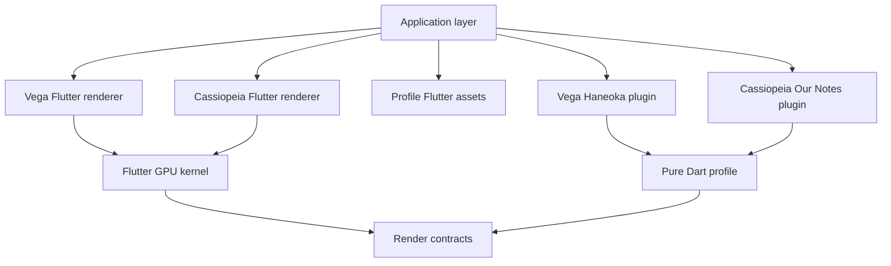

# Haneoka render profile

`haneoka_render_profile` provides pure Dart source data models, animation curves, particle integration, projection, material descriptions and adapters to the generic drawing contracts. The Vega and Cassiopeia game plugins share the original game's presentation rules here.

`flutter/` is the optional `haneoka_render_profile_flutter` package. It declares Flutter assets, the shader bundle and asset addresses. The application layer imports it and hands assets to the loaders. The pure package and game plugins use relative asset identities.



Both renderers take generic scene and asset contracts. Game rules, asset choice and original animation behaviour come from the game plugins and this profile. The host supplies windows, files, audio and asset location.

Check the pure Dart part on its own:

```sh
dart pub get
dart analyze lib
```

The drawing contracts are pinned to a Git revision of `render-kernel-flutter`. For local integration, use each package's own `pubspec_overrides.yaml`. The root `assets` and `shaders` are compatibility links into `flutter/`, so existing asset producers keep writing the same files.

A theme declares its capabilities and each file's SHA-256 and byte length in `flutter/assets/profile/manifest.json`. Run `node tool/build-manifest.mjs` after changing assets, and `node tool/build-manifest.mjs --check` before a release. The Flutter loader verifies files as it reads them, and large text uses Flutter's background decoding.

Chapters keep their provider, version and media identity, and a visual theme has its own identity and asset manifest. A historical measurement pack's `sourceId` records where it was measured. New fonts, images and layout calibration each keep their real source.

Update the production story fonts and sprites from verified descriptors, object archives and output files:

```sh
node tool/export-story-assets.mjs --inputs tool/story-assets-v56.json --profile flutter/assets/profile
```

The tool keeps the production font compact format, verifies input SHA-256, and records each asset's server, resource version and original output. Layout and animation keep their existing sources. The production tools need Node.js 24+.

Font coverage data is exported at build time, pixel by pixel from the original PNG alpha channel, as gzip-compressed R8. Coordinates, SDF margins, kerning and sampling resolution keep their original values. `font-coverage.json` records the size and the hashes of the source image and the decompressed data. At run time the profile decompresses it in the background and hands it to the generic texture loader, and SDF materials explicitly select the red coverage channel. The original alpha material still works.

```sh
python3 tool/export-font-coverage.py --profile flutter/assets/profile
node tool/build-shaders.mjs --compiler /path/to/flutter/bin/cache/artifacts/engine/linux-x64/impellerc
node tool/build-manifest.mjs
```

Offline coverage export uses Pillow. Run-time decompression and verification are pure Dart, and both Flutter renderers share one texture interface.

## License

[MPL-2.0](LICENSE).
